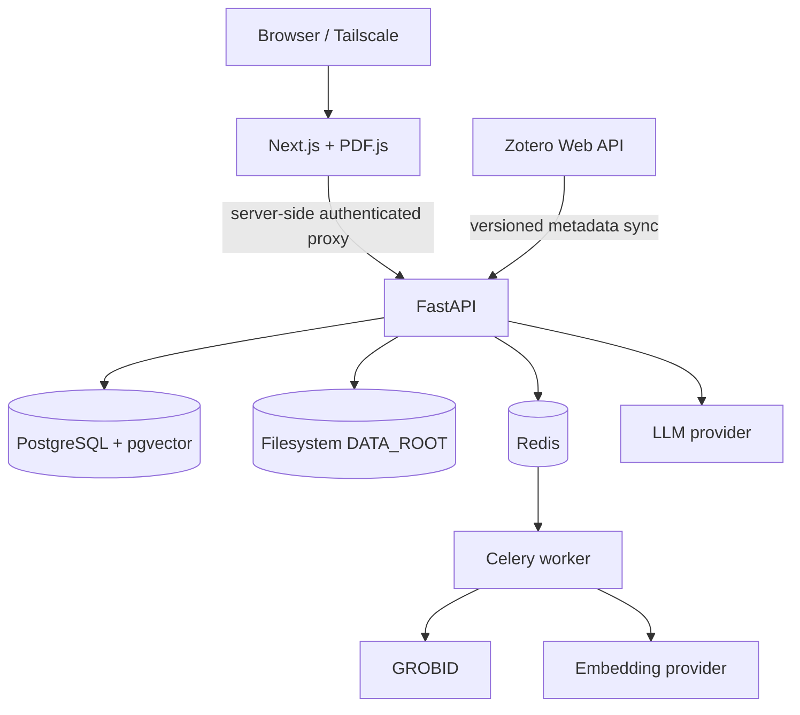

# PaperMind

PaperMind is a personal, self-hosted scientific reading workspace: Zotero-backed bibliography
management, server-owned PDF storage, structured scientific parsing, in-browser reading, and
paper-specific AI Q&A with evidence.

> V1 is intentionally single-user and private-network-first. It is a solid development foundation,
> not a public SaaS deployment.

## Responsibility boundaries

| System | Owns |
|---|---|
| Zotero | Titles, authors, DOI, journal, dates, collections, tags |
| PaperMind | PDFs, TEI, sections, chunks, embeddings, conversations, evidence |
| LLM provider | Replaceable inference only; the library works without it |

PaperMind never reads PDFs from Zotero Cloud Storage. You can disable Zotero file syncing and keep
PDFs on your own server while continuing to use Zotero and Zotero Connector for bibliography entry.



Celery is used instead of RQ because the document pipeline needs bounded retries, visible task
state, and a clean path to composed workflows. API and worker share one Python package and image.

## Repository

```text
PaperMind/
├── backend/                 FastAPI app, Alembic, worker, services
├── frontend/                Next.js App Router UI and PDF.js reader
├── worker/                  worker boundary documentation
├── scripts/                 portable administration notes
├── docker/                  production image definitions
├── docs/                    architecture and operations guides
├── tests/backend/           credential-free unit/API tests
├── .github/workflows/ci.yml
├── docker-compose.yml
├── docker-compose.dev.yml
├── pyproject.toml
└── Makefile
```

## Quick start with Docker

Requirements: Docker Engine and Compose v2. GROBID is memory-hungry; allocate at least 4 GB to
Docker, preferably 6–8 GB.

```bash
cp .env.example .env
# Edit .env: set strong POSTGRES_PASSWORD and APP_API_KEY values.
docker compose up --build
```

Open <http://localhost:3000>. The backend API is available on loopback at
<http://localhost:8000/docs>. Seed credential-free demo metadata if desired:

```bash
docker compose exec backend python -m app.cli seed-demo
```

Compose persists PostgreSQL, Redis, GROBID models, and PaperMind data in named volumes. See
[deployment](docs/deployment.md) for backups and Tailscale access.

## Source development without Docker

Python 3.11+ (3.12 recommended), Node 22, pnpm 11, PostgreSQL with pgvector, Redis, and GROBID are
needed for the complete application. Unit tests do not require external services.

```bash
python -m venv .venv
# Linux/macOS: source .venv/bin/activate
# Windows PowerShell: .venv\Scripts\Activate.ps1
python -m pip install -e ".[dev]"

copy .env.example .env            # Windows
# cp .env.example .env            # Linux/macOS
cd backend
alembic upgrade head
uvicorn app.main:app --reload
```

In separate shells from the repository root:

```bash
cd backend && celery -A app.worker.celery_app worker --loglevel=INFO
cd frontend && pnpm install --frozen-lockfile && pnpm dev
```

For external services, set `DATABASE_URL`, `REDIS_URL`, `GROBID_URL`, and `DATA_ROOT` in `.env`.
No path is hard-coded. See [HPC development](docs/hpc-development.md) for virtualenv/Conda,
offline dependency preparation, remote services, and Apptainer guidance.

## Configuration

All configuration is environment-based. `.env` is ignored; `.env.example` contains no credentials.

| Variable | Purpose |
|---|---|
| `APP_API_KEY` | Shared backend key held by the Next server proxy |
| `DATABASE_URL` | SQLAlchemy PostgreSQL URL (`postgresql+psycopg://…`) |
| `REDIS_URL` | Celery broker/result URL |
| `DATA_ROOT` | Root of server-owned PDF/TEI storage |
| `MAX_UPLOAD_MB` | Upload limit, default 100 MB |
| `GROBID_URL` | GROBID service base URL |
| `ZOTERO_API_KEY`, `ZOTERO_USER_ID` | Read-only Zotero Web API access |
| `ZOTERO_LIBRARY_TYPE` | `user` or `group` |
| `LLM_PROVIDER`, `EMBEDDING_PROVIDER` | Provider selectors; V1 implements `openai` |
| `OPENAI_API_KEY` | Optional until embedding/chat is used |
| `OPENAI_MODEL` | Chat model |
| `OPENAI_EMBEDDING_MODEL`, `EMBEDDING_DIMENSION` | Embedding configuration |
| `CHUNK_TARGET_TOKENS`, `CHUNK_OVERLAP_TOKENS` | Scientific chunk sizing |
| `CHAT_HISTORY_MESSAGES` | Maximum prior messages sent with a follow-up question (default 8) |

## Zotero synchronization

Create a Zotero API key with library read permission and find the numeric user/group ID. Configure
the three Zotero variables, then use either:

```bash
python -m app.cli zotero-sync
curl -X POST -H "X-API-Key: $APP_API_KEY" http://localhost:8000/api/zotero/sync
```

Sync stores Zotero's library version and requests only changed items, collections, and deletions on
later runs. Deleting a Zotero item hides it from the normal PaperMind library but preserves local
PDFs/history. Details are in [Zotero integration](docs/zotero-integration.md).

## Upload, processing, retrieval, and chat

Open a synchronized/demo paper and choose **Upload PDF**, or post multipart form data to
`/api/papers/{paper_id}/attachments`. The API checks size, MIME/signature, and SHA-256 duplication,
then stores `papers/<paper_uuid>/<attachment_uuid>/original.pdf` under `DATA_ROOT`.

The first PDF becomes the paper's active PDF. A later upload is stored without replacing it unless
the caller explicitly requests replacement; the UI's **Replace active PDF** action does so and
triggers reprocessing. The worker asks GROBID for TEI XML, preserves sections/paragraphs and
best-effort pages, chunks within sections, and embeds in batches. Retrieval is scoped to the active
PDF and combines PostgreSQL full-text search with pgvector cosine similarity. Assistant responses
store retrieved context separately from the excerpts actually cited; evidence buttons jump the
reader to a page when GROBID supplied one. See
[PDF processing](docs/pdf-processing.md).

OpenAI is isolated behind `EmbeddingProvider` and `LLMProvider`. Adding Anthropic, Gemini, Ollama,
or vLLM does not require changing route handlers or persistence models.

## Authentication and networking

FastAPI endpoints require `X-API-Key`. Browser requests go through a same-origin Next.js server
proxy, keeping that key out of the client bundle. This is appropriate as defense in depth for one
user on Tailscale; it is not a public-internet identity system. Compose exposes the frontend and a
loopback development API only. PostgreSQL, Redis, GROBID, and Celery are never published.

The recommended path is device → Tailscale → home server → frontend. No public IP or port
forwarding is required. Follow [deployment](docs/deployment.md).

## Quality checks

```bash
python -m pip install -e ".[dev]"
ruff format --check backend tests
ruff check backend tests
pytest

cd frontend
pnpm lint
pnpm typecheck
pnpm build
```

GitHub Actions runs those checks plus backend/frontend Docker image builds. Tests use SQLite,
fixtures, and mocks; no real Zotero or OpenAI credential is required.

## Documentation

- [Architecture](docs/architecture.md)
- [Data model](docs/data-model.md)
- [Zotero integration](docs/zotero-integration.md)
- [PDF processing](docs/pdf-processing.md)
- [Deployment and Tailscale](docs/deployment.md)
- [HPC development](docs/hpc-development.md)
- [Future Zotero Desktop agent](docs/zotero-desktop-agent.md)

## V1 limitations

- Single-user shared-key authentication; no public hosting or roles.
- One active PDF is shown and queried at a time; supplementary-file browsing is not yet exposed.
- No OCR, Zotero annotation compatibility, or exact evidence highlighting.
- Page numbers depend on available GROBID TEI markers.
- OpenAI is the only implemented AI provider, though interfaces are provider-neutral.
- Exact vector search is used until corpus size justifies a dimension-specific HNSW index.
- Zotero sync is manually triggered (API/CLI); scheduling is deployment-specific.

## Planned V2 directions

Desktop-assisted Zotero PDF ingestion, local Ollama/vLLM providers, annotations/highlights,
text-span evidence navigation, cross-paper retrieval, background sync scheduling, S3/MinIO storage,
OCR, figure reasoning, related-paper discovery, and stronger session authentication.

## License

[MIT](LICENSE)

