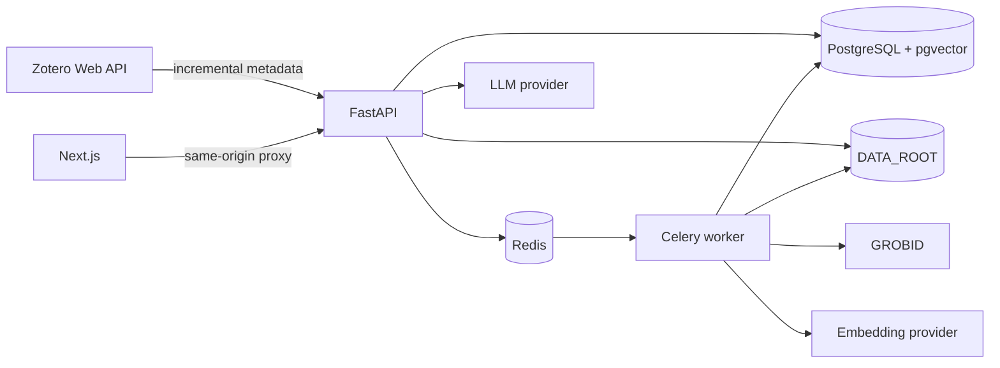

# Architecture

PaperMind separates three sources of responsibility:

- Zotero is authoritative for bibliography metadata, tags, and collections.
- PaperMind is authoritative for PDFs, parsed documents, reading state, and conversations.
- AI providers are optional, replaceable compute dependencies.

The backend uses synchronous SQLAlchemy because V1 traffic is single-user and most work is moved
off-request to Celery. Celery was selected over RQ for mature retry controls, task state, and a
clear path to multi-step workflows. The API and worker share one package and image, preventing
drift between their models and processing code.

External boundaries are interfaces: `StorageBackend`, `EmbeddingProvider`, and `LLMProvider`.
Only local filesystem storage and OpenAI providers ship in V1. Adding MinIO, Ollama, vLLM, or
another hosted provider should not change route or database code.

## Failure isolation

Metadata reads continue if AI is unavailable. Stored PDFs continue to work if Zotero is down.
Processing state and a bounded error message are recorded on each attachment. GROBID, Redis,
PostgreSQL, and the backend are bound only to the Compose network; only the frontend and loopback
backend development port are published.

